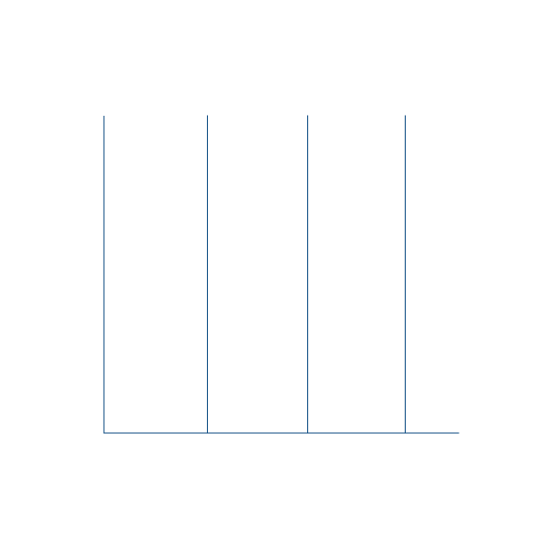

<h1 align="center"><b>Hi 👋, I'm Hamza Ben Younes</b> </h1>

  

  

| 🌐 Language | |
| :---: | :---: |
| [English](./README.md) |  |
| [Français](./README-FR-FRA.md) |  |
| [العربية](./README-AR-SA.md) |  |

##  About Me

I am **Hamza Ben Younes**, a Tunisia-based developer and data enthusiast focused on **Business Intelligence, Data Analytics and full-stack software development**. I earned a **Bachelor's degree in Information Systems Development** from **ISET Bizerte (2021–2024)** with high honors and pursued **master's studies in Business Intelligence & Data (2024–2026)**.

I enjoy turning data into actionable insights through **Power BI, DAX, SQL and Python**, and building applications with **Java, Spring Boot, Angular and React**. My graduation project, developed in collaboration with **Medianet Consulting**, focused on an intelligent, multi-company human resources management platform.

## 🎯 Current Focus

- 📊 **Data analytics & BI:** interactive dashboards, KPIs, data visualization and reporting.
- 🧠 **Growing expertise:** ETL pipelines, advanced SQL, machine learning and data engineering.
- 💻 **Software engineering:** REST APIs, web applications and data-informed digital products.
- 🤝 **Collaboration:** data analytics, AI-enabled tools and full-stack projects.

# <b>Let’s Connect!</b> 

  
  
  
  

  
  

##  Technical Skills

     
     
     

## 🎓 Education & Experience

- **2024–2026 — Master's studies:** Business Intelligence & Data (as listed on LinkedIn).
- **2021–2024 — ISET Bizerte:** Bachelor's in Information Systems Development; graduated with high honors.
- **Medianet Consulting — Academic-industry project collaboration:** contributed to an intelligent multi-company HR management platform during the final-year project.
- **Data & development interests:** Power BI, DAX, SQL, Python, Java, Angular and Spring Boot.

## 🏅 Certifications

- **EF SET English Certificate — C2 Proficient (75/100)** — [View certificate](https://efset.org/cert/3JDbKU).
- **Google — Fundamentals of Digital Marketing** — shown on LinkedIn.

## 🚀 Featured Projects

- **[STIR — Treasury Automation & AI-Assisted Auditing](https://github.com/Hamzabny/STIR_Automatisation_Agent-IA)** — Python workflow for tracking Excel source changes, preparing financial sheets, generating audit alerts and optional AI-assisted explanations.
- **[GestionFaculte — Faculty Management](https://github.com/Hamzabny/GestionFaculte)** — Faculty-management application project.
- **[GestionFaculte — Spring Boot](https://github.com/Hamzabny/GestionFaculte-springboot)** — Java / Spring Boot faculty-management backend project.
- **[AutoDrive TN](https://github.com/Hamzabny/Autodrive_TN)** — Automotive platform project repository.
- **[dog_app](https://github.com/Hamzabny/dog_app)** — Flutter mobile application project.
- **Android Education Platform** — Educational Android application developed using Android Studio and Spring Boot (listed on LinkedIn).

##  GitHub Stats

### ✍️ Developer Quote

 Additional GitHub statistics

---

**Template inspiration / original visual design:** [Aziz Ben Ismail](https://github.com/AzizBenIsmail). **Personalized content:** [Hamza Ben Younes](https://github.com/Hamzabny).
